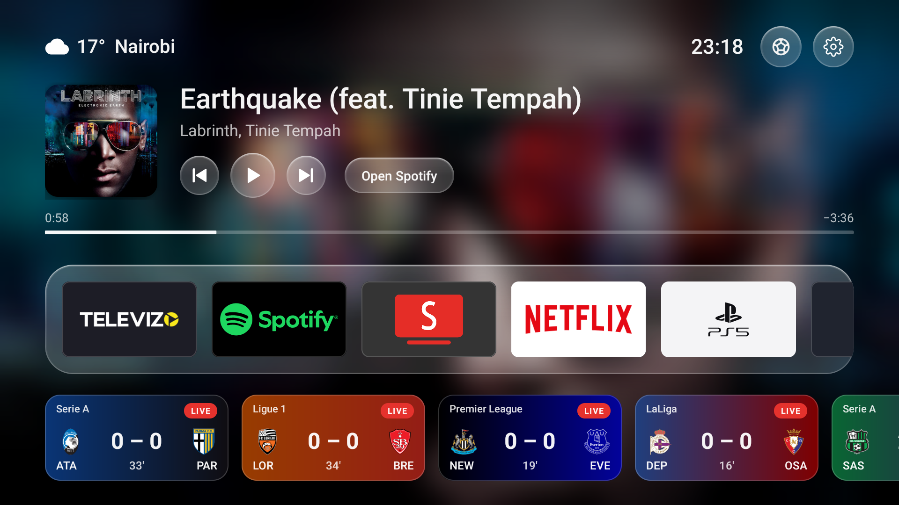
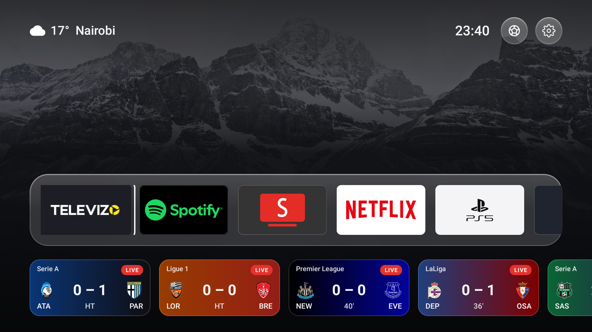
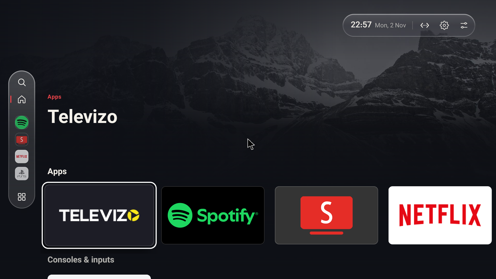
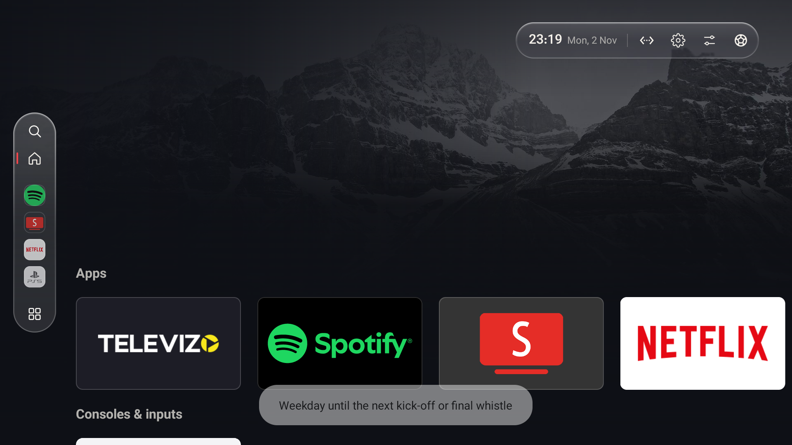

<h1 align="center">Matchday / Non-matchday TV Launcher</h1>

<p align="center">
  An Android TV / Google TV home screen that changes itself on football days.<br>
  A free, open-source fork of <a href="https://github.com/KoolestTVLauncher/Koolest-TV-Launcher">Koolest TV Launcher</a> (GPL-3.0).
</p>

<p align="center">
  
</p>

The TV has two home screens and picks one by itself:

| | **Non-match day** (the "weekday" home) | **Match day** |
|---|---|---|
| When | Every day without a match | From the first kick-off of the day until the last final whistle |
| Look | Koolest's own dark home: menu rail, billboard, rows | "Scenic Glass": a clear photo (or the playing album's art, blurred), weather, clock, a big music player, a floating glass dock, live score cards |
| Leagues | — | Premier League, LaLiga, Bundesliga, Serie A, Ligue 1, UEFA Champions League |

Plus:

- **A switch button (âš½) on both home screens** and **a phone page** with Match day / Weekday / Automatic buttons, so you can switch by hand from the sofa or your phone. A manual switch holds until the next kick-off or final whistle, then the TV goes back to automatic.
- **Your team, on automatically.** 30 minutes before every game of one team (Arsenal in this build, any competition), the TV opens your IPTV app and puts the channel showing the game on, full screen. It finds the broadcasters from public TV listings, searches them in the app, and tries them until one plays cleanly, FHD first.
- **Music that lives on the home screen** (from Koolest's base, extended): the album art becomes the background, a glass player with previous/play/next, and a music card that floats over the screensaver.

Everything runs on the TV. No server, no account, no API keys, no third-party libraries.

## Screenshots

| Match day, nothing playing | Non-match day (weekday) home |
|---|---|
|  |  |

| Switching by hand (the âš½ button) | Match day with music and live scores |
|---|---|
|  |  |

## Quick start

You need: an Android TV / Google TV (Android 8+), a computer with [adb](https://developer.android.com/tools/releases/platform-tools), and JDK 17 to build.

```bash
git clone https://github.com/ShirQUillE-SandE/matchday-nonmatchday-tv-launcher.git
cd matchday-nonmatchday-tv-launcher
./gradlew assembleSideloadRelease      # Windows: gradlew.bat assembleSideloadRelease
adb connect <tv-ip>:5555
adb install -r app/build/outputs/apk/sideload/release/app-sideload-release.apk
adb shell cmd role add-role-holder --user 0 android.app.role.HOME dev.koolest
adb shell cmd package set-home-activity dev.koolest/.MainActivity
```

Signing, permissions, the phone page, the team auto-open and every test command are in **[docs/SETUP.md](docs/SETUP.md)**.

## How it works

| Piece | File | What it does |
|---|---|---|
| Match day | [`MatchDay.kt`](app/src/main/java/dev/koolest/MatchDay.kt) | Fetches the day's fixtures from ESPN's public scoreboard (6 leagues), decides match day in the TV's time zone, draws the Scenic Glass home (`MatchHome`) and the score cards. Fetches a few times a day, every minute only while matches are on. Offline: keeps the normal home. |
| Switching | [`MainActivity.kt`](app/src/main/java/dev/koolest/MainActivity.kt) (`applyMatchDay`, `switchMode`) | Checks every 30 s while the home screen shows; hides Koolest's rows and shows the match-day screen, or back. |
| Phone page | [`ModeServer.kt`](app/src/main/java/dev/koolest/ModeServer.kt) | A one-page web server on the home Wi-Fi (port 8765) behind a random secret code. |
| Team auto-open | [`ArsenalWatch.kt`](app/src/main/java/dev/koolest/ArsenalWatch.kt) | Exact alarm 30 min before kick-off (ESPN team schedule). Broadcasters from LiveSoccerTV (worldwide) and live-footballontv.com (UK). Drives the IPTV app through the TV's own adb (`SelfAdb`): search, pick, full screen, check the player really plays. |
| Music | [`MusicLive.kt`](app/src/main/java/dev/koolest/MusicLive.kt), [`DreamOverlay.kt`](app/src/main/java/dev/koolest/DreamOverlay.kt) | Spectrum from Android's Visualizer, music-reactive background, glass music card over the screensaver. |

Full list of changes from Koolest 2.5.1: [docs/CHANGES.md](docs/CHANGES.md).

## Made with AI

This build was made by describing it in plain English to an AI coding assistant (Claude Code), testing every step on a real TCL TV over adb. The prompts are in **[docs/PROMPTS.md](docs/PROMPTS.md)** so you can remix them for your own team, leagues or look.

## Good to know

- **Unofficial data.** ESPN's scoreboard, LiveSoccerTV and live-footballontv.com are public pages, not official APIs. They can change without notice; when they do, the launcher falls back to the normal home and simply doesn't auto-open. Be gentle with them: the code fetches rarely on purpose.
- **IPTV.** The auto-open works with an IPTV player app (tested with OttPlay, also branded Televizo). Use it only with services you are licensed to watch. Nothing here provides channels or streams.
- **Tested on** a TCL BeyondTV2 (Android 11, 1080p, 2 GB RAM). Screen taps for the IPTV app's full-screen button are in 1080p coordinates; see SETUP for other screens.

## License

GPL-3.0, like Koolest. Original work © the Koolest TV Launcher authors; match-day changes © their contributors. See [LICENSE](LICENSE). Koolest's own README is kept at [docs/KOOLEST-README.md](docs/KOOLEST-README.md).

Team crests and league names belong to their owners and are shown only as data from the scoreboard. App banners shown in screenshots belong to their owners.
